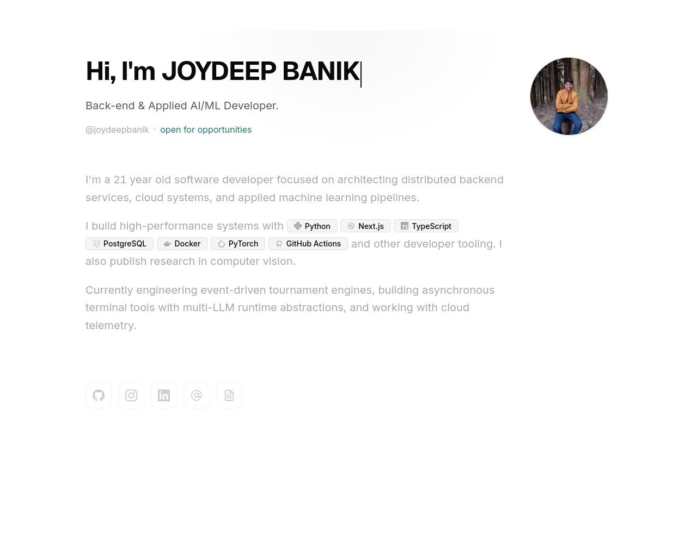
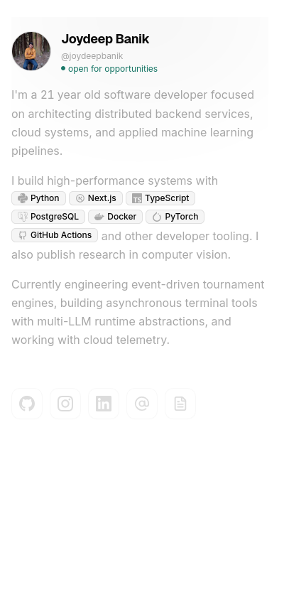

<div align="center">

  <h1>Joydeep Banik</h1>
  <p><strong>Personal Developer Portfolio &amp; Digital Playground</strong></p>

  <p>
    <a href="https://joydeepbanik.me"><strong>Explore Live Site &rarr; joydeepbanik.me</strong></a>
  </p>

  <p>
    <a href="https://joydeepbanik.me"></a>
    <a href="https://nextjs.org"></a>
    <a href="https://react.dev"></a>
    <a href="https://www.typescriptlang.org"></a>
    <a href="https://tailwindcss.com"></a>
  </p>

  <br />

  <table align="center">
    <tr>
      <td align="center" valign="top" width="70%">
        <strong>Desktop Preview</strong><br /><br />
        <a href="https://joydeepbanik.me">
          
        </a>
      </td>
      <td align="center" valign="top" width="30%">
        <strong>Mobile Preview</strong><br /><br />
        <a href="https://joydeepbanik.me">
          
        </a>
      </td>
    </tr>
  </table>

</div>

---

## 🌟 Overview

A modern, high-performance developer portfolio crafted with an emphasis on fluid motion, tactile micro-interactions, and minimalism. Built with **Next.js 16**, **React 19**, and **Tailwind CSS 4**, pre-rendered to a standalone **Static HTML Export** (`output: "export"`) and deployed on **Vercel**.

---

## ✨ Features

- **⚡ Blazing Fast Static Architecture:** Pre-rendered with zero server overhead for instant page transitions.
- **🧲 Fluid Micro-Interactions & Physics:**
  - Magnetic cursor-following buttons.
  - Floating macOS-style spring-physics dock with hover magnification.
  - Interactive heading scramble animation on load.
  - Smooth scroll-triggered reveal animations.
- **📊 Live GitHub Activity Heatmap:** Real-time contribution calendar synced directly from GitHub.
- **💼 Interactive Project Showcase:** Expandable project cards with tech tags, live preview links, and source code shortcuts.
- **📜 Experience Timeline:** Clean, minimal experience badges detailing internships and engineering roles.
- **📬 Working Contact Form:** Integrated form that delivers visitor messages straight to email via Formspree API.
- **🎨 Dark Minimal Aesthetic:** Thoughtfully tuned dark theme tokens, subtle borders, ambient radial glows, and responsive typography.

---

## 🎨 Use This Template for Your Own Portfolio

Want to use this design for your own developer site? You can fork and customize it in minutes!

```bash
# 1. Clone the repository
git clone https://github.com/Joydeep2005Banik/joydeepbanik.me.git my-portfolio
cd my-portfolio

# 2. Install dependencies
npm install

# 3. Start local development server
npm run dev
```

### 📖 Step-by-Step Customization Guide

For detailed instructions on editing your bio, replacing projects, connecting your own GitHub activity heatmap, configuring the contact form, and setting up a custom domain on Vercel:

👉 **[Read the complete Reproduction & Setup Guide (REPRODUCE.md)](REPRODUCE.md)**

---

## 🛠️ Tech Stack

| Layer | Technology |
| :--- | :--- |
| **Framework** | [Next.js 16](https://nextjs.org/) (App Router, Static Export) |
| **Frontend Library** | [React 19](https://react.dev/) |
| **Language** | [TypeScript 5](https://www.typescriptlang.org/) |
| **Styling** | [Tailwind CSS 4](https://tailwindcss.com/) + Custom CSS Tokens |
| **Animations** | [Framer Motion](https://www.framer.com/motion/) |
| **Icons** | [Lucide React](https://lucide.dev/) & [React Icons](https://react-icons.github.io/react-icons/) |
| **Hosting & DNS** | [Vercel](https://vercel.com/) + Custom Domain via Namecheap |

---

## 📂 Project Structure

```bash
├── app/
│   ├── blog/              # Experience & writing list view
│   ├── components/        # UI components (Dock, ProjectCard, Intro, Socials, etc.)
│   ├── contact/           # Contact form page
│   ├── projects/          # Full projects page
│   ├── resume/            # Embedded PDF resume viewer
│   ├── layout.tsx         # Global layout, fonts, and SEO metadata
│   ├── globals.css        # Theme variables, glassmorphism, and animations
│   ├── manifest.ts        # Dynamic Web App Manifest
│   └── sitemap.ts         # Automated XML sitemap generator
├── DB/
│   ├── projects.json      # Central data store for project cards
│   └── quotes.json        # Curated quotes for the footer
├── lib/
│   ├── markdown.ts        # Frontmatter parser and markdown pipeline
│   └── posts.ts           # Experience data loader and sorter
├── posts/                 # MDX files representing experience items
├── public/                # Static assets (screenshots, images, resume, favicons)
└── next.config.ts         # Next.js configuration (static export, unoptimized images)
```

---

## 📦 Building for Production

To build the static site locally:

```bash
npm run build
```

This compiles your application into standalone static HTML/CSS/JS files inside the `/out` directory. You can preview the production build locally using:

```bash
npx serve out
```

---

## 📄 License

This project is open source and available under the [MIT License](LICENSE).
